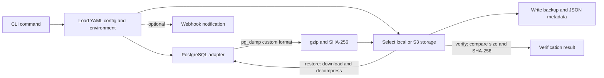

# DbVault

DbVault is a command-line utility for backing up and restoring PostgreSQL databases. It creates compressed backups, records a SHA-256 checksum, and stores the backup either on the local filesystem or in an S3-compatible object store.

> **Project status:** early-stage software (currently `0.1.0`). Review the limitations and test a restore into a disposable database before relying on DbVault for important data. It does not replace a tested disaster-recovery plan.

## What it can do

- Create PostgreSQL custom-format dumps, gzip-compress them, and save them locally or to S3-compatible storage.
- Verify a backup against its recorded size and SHA-256 checksum.
- List backups in a storage location.
- Restore a complete database or selected tables. Restore requires explicit confirmation unless `--yes` is supplied.
- Send success/failure messages to an HTTP webhook (optional).
- Run as a Java application or as a Docker container.

There is **no separate upload command**: `backup --storage s3` writes the backup directly to the configured S3 storage.

## Contents

- [How DbVault works](#how-dbvault-works)
- [Requirements](#requirements)
- [Quick start: Docker Compose](#quick-start-docker-compose)
- [Use the published GHCR image](#use-the-published-ghcr-image)
- [Build and run from a source checkout](#build-and-run-from-a-source-checkout)
- [Configuration](#configuration)
- [Commands](#commands)
- [Examples](#examples)
- [Scheduling](#scheduling)
- [Design decisions](#design-decisions)
- [Limitations and safety notes](#limitations-and-safety-notes)
- [Troubleshooting](#troubleshooting)

## How DbVault works



For a backup, DbVault runs `pg_dump`, compresses the stream, and calculates SHA-256 over the bytes it stores. It writes a JSON sidecar with the backup's name, database, creation time, size, and hash. A backup named `appdb-2026-11-20T13-13-12.dump.gz`, for example, has metadata named `appdb-2026-11-20T13-13-12.dump.gz.json`.

For restore, DbVault downloads the selected backup, decompresses it, and passes the PostgreSQL custom-format dump to `pg_restore`. For verification, it checks that the backup and sidecar exist, then compares both the recorded size and SHA-256 hash.

## Requirements

### To run the packaged Docker image

- Docker Engine or Docker Desktop.
- Network access from the DbVault container to PostgreSQL and, if selected, the S3-compatible service.
- A configuration file and secrets supplied at runtime.

The image includes Java 25 and PostgreSQL 18 client tools (`pg_dump`, `pg_restore`, and `psql`). When connecting to a PostgreSQL server newer than the bundled client, check PostgreSQL's client/server compatibility requirements.

### To build or run the JAR locally

- JDK 25.
- Maven.
- PostgreSQL client tools (`pg_dump`, `pg_restore`, and `psql`) on `PATH`. Use a client version compatible with the PostgreSQL server.

DbVault launches these client programs; the Java application does not implement the PostgreSQL wire protocol itself.

## Quick start: Docker Compose

The repository includes a development `docker-compose.yml` with PostgreSQL and Garage. Its PostgreSQL service publishes port `5433` on the host and uses the example database `testdb` and user `dbvault`. Those credentials are for local development only—change them before using this setup for anything sensitive.

1. Copy the example configuration and environment file:

   ```powershell
   Copy-Item dbvault.example.yml dbvault.yml
   Copy-Item .env.example .env
   ```

   Edit `dbvault.yml` and `.env`. Use the configuration example below as a starting point. For the existing Compose PostgreSQL service, use `host: localhost` and `port: 5433` when running DbVault on the host.

2. Start PostgreSQL:

   ```powershell
   docker compose up -d postgres
   ```

3. Build the image from this checkout:

   ```powershell
   mvn -B verify
   docker build -t dbvault:local .
   ```

   For a portable container-to-container connection, follow the Compose service setup below and use `image: dbvault:local` instead of the GHCR image. This builds from your checkout and does not pull an image from GHCR.

### Run DbVault as a service on the same Compose network

When both PostgreSQL and DbVault are Compose services, use the PostgreSQL service name and its **container port** (`postgres:5432`), not the host-published port. In `dbvault.yml`, configure the database like this:

```yaml
database:
  type: postgres
  name: testdb
  username: dbvault
  password: ${DB_PASSWORD}
  host: postgres
  port: 5432
```

Do not set `database.container` in this mode. DbVault then uses its bundled PostgreSQL client to connect over the Compose network. Add a DbVault service to `docker-compose.yml`:

```yaml
  dbvault:
    image: ghcr.io/veliahmedov/dbvault:latest
    working_dir: /work
    volumes:
      - ./dbvault.yml:/work/dbvault.yml:ro
      - ./.env:/work/.env:ro
      - ./backups:/work/backups
    depends_on:
      - postgres
```

Create the host backup directory if it does not exist, then run:

```powershell
New-Item -ItemType Directory -Force backups
docker compose run --rm dbvault backup --config dbvault.yml
docker compose run --rm dbvault list --config dbvault.yml
```

The service uses the same Compose network as `postgres`. If this repository is used from another directory or Compose project, adjust the bind-mount paths and service names accordingly. To use the image built from your checkout, replace the `image` value with `dbvault:local` after building the Dockerfile locally.

## Use the published GHCR image

The release workflow publishes `ghcr.io/veliahmedov/dbvault` with a `latest` tag, a semantic-version tag (for example `0.1.0`), and a commit-SHA tag. Images are published when the release workflow runs. Pin a version for repeatable deployments rather than relying on `latest`.

```powershell
docker pull ghcr.io/veliahmedov/dbvault:latest
# Or pin a release:
docker pull ghcr.io/veliahmedov/dbvault:0.1.0
docker run --rm ghcr.io/veliahmedov/dbvault:latest --help
```

The package must be public for anonymous pulls. If GitHub reports an authorization error, authenticate with a GitHub token that has `read:packages` access:

```powershell
$env:GHCR_TOKEN | docker login ghcr.io -u YOUR_GITHUB_USERNAME --password-stdin
```

Do not put a token directly into a command or commit it to a file.

For a regular run, mount the configuration, `.env`, and a persistent backup directory. Run the container from the directory containing the config so DbVault finds `.env` there. For instance, if PostgreSQL is reachable from the host at port 5433, set `host: host.docker.internal` and `port: 5433` in the mounted `dbvault.yml`:

```powershell
New-Item -ItemType Directory -Force backups
docker run --rm --add-host host.docker.internal:host-gateway `
  -v "${PWD}:/work" -w /work `
  ghcr.io/veliahmedov/dbvault:0.1.0 `
  backup --config dbvault.yml
```

Docker Desktop for Windows and macOS already provides `host.docker.internal`; if `--add-host` is not accepted by your Docker platform, remove that option. On Linux, `host-gateway` requires a recent Docker version. Alternatively, join the container to the database's Docker network and configure the database with its network hostname and container port.

The mount makes the current directory available inside the container. Keep secrets in `.env`, restrict access to that file, and do not mount or share more host paths than needed. For a database that is another Compose service, the Compose service approach above avoids host-routing differences.

## Build and run from a source checkout

Clone the repository, install JDK 25 and Maven, and install PostgreSQL client tools compatible with your server. From the repository directory:

```powershell
Copy-Item dbvault.example.yml dbvault.yml
Copy-Item .env.example .env
# Edit dbvault.yml and .env before running.
mvn -B verify
java -jar target/dbvault-0.1.0.jar --help
java -jar target/dbvault-0.1.0.jar backup --config dbvault.yml
```

`mvn -B verify` compiles the project, runs its unit tests and PostgreSQL integration test, and packages the executable shaded JAR at `target/dbvault-0.1.0.jar`. The integration test uses Testcontainers and therefore needs a working Docker environment. `mvn -B package` also creates the JAR and runs the unit-test phase, but does not run the Failsafe integration-test phase that `verify` runs.

The configuration loader reads `.env` from the process's **current working directory**, not automatically from the directory containing `--config`. It also reads operating-system environment variables; environment variables take precedence over values in `.env`. Run the command from the directory containing `.env`, or set the required variables in the process environment.

### Connecting to a database in Docker from a local JAR

If PostgreSQL is in a Docker container and its port is published on the host, configure `host` and `port` in `dbvault.yml` and install the PostgreSQL client tools locally. For the repository's Compose service, the published port is `5433`.

Alternatively, set `database.container` to the running PostgreSQL container's name. In this mode DbVault runs PostgreSQL tools through `docker exec`, so Docker must be installed and available on `PATH`, and the current user must be allowed to use the Docker daemon. Do not use `container` when running the published DbVault image: the image is designed to connect over the network and does not include the Docker CLI.

## Configuration

Start from [`dbvault.example.yml`](dbvault.example.yml). This is a representative configuration; replace example names, endpoints, and credentials to match your environment.

```yaml
database:
  type: postgres
  name: appdb
  username: dbvault
  password: ${DB_PASSWORD}
  host: localhost
  port: 5432
  # For local-JAR + Docker DB only, optionally use a container name instead:
  # container: my-postgres-container

defaultStorage: local

storages:
  local:
    type: local
    path: ./backups
  s3:
    type: s3
    endpoint: https://s3.example.com
    bucket: dbvault-backups
    region: us-east-1
    accessKey: ${S3_ACCESS_KEY}
    secretKey: ${S3_SECRET_KEY}

notification:
  webhook: ${WEBHOOK_URL}
  notifyOn: failure
```

Create a `.env` file next to the working directory from which you run DbVault:

```dotenv
DB_PASSWORD=replace-with-your-database-password
S3_ACCESS_KEY=replace-with-your-storage-access-key
S3_SECRET_KEY=replace-with-your-storage-secret-key
WEBHOOK_URL=https://example.com/your-webhook
```

If a value is not needed, remove its `${...}` placeholder from the YAML or remove the optional `notification` block. An unresolved placeholder produces an error. Do not commit real credentials; use a secrets manager or restricted environment variables for production.

### Database settings

| Key | Meaning |
| --- | --- |
| `database.type` | Use `postgres`. SQLite is not implemented yet. |
| `database.name` | Database to back up or restore. Required. |
| `database.username` | PostgreSQL role used by `pg_dump`, `pg_restore`, and `psql`. Required. |
| `database.password` | Optional password. DbVault supplies it as `PGPASSWORD` to the client process. |
| `database.host` | Network host for PostgreSQL. Defaults to `localhost` when omitted in network mode. |
| `database.port` | TCP port. Defaults to `5432` in network mode. |
| `database.container` | Optional Docker container name for the local-JAR `docker exec` mode. If set, DbVault uses Docker exec instead of `host` and `port`. |

Use the PostgreSQL service name plus the container port when DbVault and PostgreSQL share a Docker network (for example, `postgres:5432`). Use a host-reachable name and published port when DbVault runs directly on the host (for example, `localhost:5433`).

### Storage settings

`defaultStorage` names the storage used when a command has no `--storage` option. Storage names are the keys under `storages`; they can be chosen per command.

- **Local:** `path` is relative to the process working directory unless it is absolute. Mount that directory if DbVault runs in Docker, or the container's backups will disappear when it is removed.
- **S3-compatible:** configure `endpoint`, `bucket`, `accessKey`, and `secretKey`; `region` should match the object-store's signing region. The bucket must already exist and be accessible to these credentials. Use the service's internal hostname (for example, `http://garage:3900`) from a container on the same Compose network, or a host-reachable endpoint (for example, `http://localhost:3900`) from the host.

DbVault writes both the `.dump.gz` object and its `.dump.gz.json` metadata object to the selected storage.

### Notifications

The optional `notification` block sends Slack-style JSON webhook messages after `backup`, `restore`, and `verify`. `notifyOn` can be `all` or `failure`; it defaults to `all`. `list` does not send notifications. Webhook delivery failures are logged and do not turn a successful database operation into a failed command.

## Commands

Use `--help` on the root command or any subcommand to see the CLI help:

```text
dbvault --help
dbvault backup --help
dbvault restore --help
dbvault verify --help
dbvault list --help
```

For a JAR, replace `dbvault` with `java -jar target/dbvault-0.1.0.jar`. For Docker Compose, prefix a command with `docker compose run --rm dbvault`.

| Command | Purpose |
| --- | --- |
| `backup` | Create a compressed PostgreSQL backup and checksum metadata. |
| `list` | List backups in the selected storage. |
| `verify <backup>` | Check the stored backup's size and SHA-256 against its metadata. |
| `restore <backup>` | Restore a backup to the database selected in the config. Prompts for confirmation by default. |

All commands support `-c, --config <path>` (default: `dbvault.yml`). `backup`, `list`, `verify`, and `restore` support `-s, --storage <name>` to select a key from `storages`; without it, `defaultStorage` is used.

### Exit codes

| Code | Meaning |
| --- | --- |
| `0` | Command completed successfully. |
| `1` | General configuration or operation failure. |
| `2` | CLI usage error, such as an unknown command or invalid argument. |
| `3` | Backup integrity check failed (corrupt backup). |
| `4` | Restore was cancelled at the confirmation prompt. |

### Common command examples

```powershell
# Back up to default storage
dbvault backup --config dbvault.yml

# Back up directly to the configured S3 storage
dbvault backup --config dbvault.yml --storage s3

# List local backups, or list S3 backups
dbvault list --config dbvault.yml
dbvault list --config dbvault.yml --storage s3

# Verify the backup and sidecar metadata in the chosen storage
dbvault verify appdb-2026-11-20T13-13-12.dump.gz --config dbvault.yml
dbvault verify appdb-2026-11-20T13-13-12.dump.gz --config dbvault.yml --storage s3

# Restore all objects from a backup (asks you to type the configured database name)
dbvault restore appdb-2026-11-20T13-13-12.dump.gz --config dbvault.yml

# Restore selected tables (repeat --table or use comma-separated names)
dbvault restore appdb-2026-11-20T13-13-12.dump.gz --table public.users --table public.accounts --config dbvault.yml
dbvault restore appdb-2026-11-20T13-13-12.dump.gz --table users,accounts --config dbvault.yml

# Skip the interactive confirmation; use only in a controlled script
dbvault restore appdb-2026-11-20T13-13-12.dump.gz --yes --config dbvault.yml
```

The backup filename is generated from the database name and timestamp. Use the exact name printed by `backup` or shown by `list`. Restore and verification can also use `--storage s3` when the backup is in S3.

## Examples

### Back up a local PostgreSQL server to disk

Set `database.host` to `localhost`, `database.port` to the server's port (commonly `5432`), and configure the database name, user, and password. Set the local storage path, then run:

```powershell
dbvault backup --config dbvault.yml
dbvault list --config dbvault.yml
```

The backup and JSON sidecar appear under the configured local path.

### Back up PostgreSQL running in Docker

There are two supported connection patterns:

1. **Network connection (recommended for Dockerized DbVault):** put the containers on the same network and use the database service/container hostname and its internal port, such as `postgres:5432`. Do not configure `database.container`.
2. **Docker exec (local JAR only):** configure `database.container` with the actual running container name. The local machine needs Docker CLI access. DbVault executes `pg_dump`, `pg_restore`, and `psql` inside that database container, so those client tools must be present there.

For the repository's Compose database when DbVault runs on the host, use `localhost:5433`, because Compose maps host port 5433 to container port 5432.

### Back up and restore through S3-compatible storage

Configure an S3 storage entry and ensure its bucket exists before running DbVault. Then:

```powershell
dbvault backup --config dbvault.yml --storage s3
dbvault list --config dbvault.yml --storage s3
dbvault verify appdb-2026-11-20T13-13-12.dump.gz --config dbvault.yml --storage s3
dbvault restore appdb-2026-11-20T13-13-12.dump.gz --config dbvault.yml --storage s3
```

The restore command still targets the database configured in `dbvault.yml`; the storage option only chooses where the backup is read from.

## Scheduling

DbVault does not include a scheduler. Schedule a normal `backup` command with your operating system, and ensure the scheduler's working directory contains `dbvault.yml` and `.env` (or provide environment variables another way). The examples below use the Compose service from [Run DbVault as a service on the same Compose network](#run-dbvault-as-a-service-on-the-same-compose-network); adapt the directory and image to your installation.

### Linux and macOS: cron

From a terminal, confirm that this works first:

```sh
cd /opt/dbvault
docker compose run --rm dbvault backup --config dbvault.yml
```

Create the log directory and edit the crontab with `crontab -e`. For a backup every day at 02:00, add:

```cron
0 2 * * * cd /opt/dbvault && /usr/bin/docker compose run --rm dbvault backup --config dbvault.yml >> /opt/dbvault/dbvault-cron.log 2>&1
```

Use the full path to Docker (`command -v docker`) if it is not `/usr/bin/docker`. Docker must be running, and the account that owns the crontab must have permission to access it. Cron has a small environment, so use absolute paths and make sure `.env` is in `/opt/dbvault`. Check the log after the first scheduled run. To schedule the local JAR instead, use the full Java executable and JAR paths in the same pattern, with a compatible PostgreSQL client on `PATH`.

### Windows: Task Scheduler

First verify the Compose command manually in PowerShell from the project directory:

```powershell
docker compose run --rm dbvault backup --config dbvault.yml
```

Then create a task in **Task Scheduler**:

1. Choose **Create Task** (or **Create Basic Task**) and configure the desired daily or weekly trigger.
2. Add an action **Start a program**.
3. Set **Program/script** to the full path to `docker.exe` (find it with `Get-Command docker`).
4. Set **Add arguments** to `compose run --rm dbvault backup --config dbvault.yml`.
5. Set **Start in** to the directory containing `docker-compose.yml`, `dbvault.yml`, and `.env` (for example, `C:\dbvault`).
6. Ensure Docker Desktop is running for the account that runs the task. Save the task, run it once manually from Task Scheduler, and check its result and Docker logs.

The `--rm` option removes the one-off DbVault container after the command finishes; it does not remove the mounted backup files. For the local JAR, set **Program/script** to the full path to `java.exe`, **arguments** to `-jar target\dbvault-0.1.0.jar backup --config dbvault.yml`, and **Start in** to the directory containing the config and `.env`.

## Design decisions

- **PostgreSQL's native custom dump format:** `pg_dump --format=custom` preserves PostgreSQL restore capabilities, including selective table restoration through `pg_restore`.
- **Streaming backup creation:** database output is compressed and hashed as it is written, avoiding the need to hold the whole backup in memory or stage a complete local dump first.
- **Gzip around the dump:** the `.dump.gz` artifact is portable across the local and S3 storage backends, while PostgreSQL's internal custom-format compression is disabled for this stream.
- **Checksum sidecar:** recording size and SHA-256 alongside each backup makes accidental truncation or modification detectable with `verify`. It is an integrity check, not a signature or authenticity guarantee.
- **Storage abstraction:** the CLI selects a configured local or S3-compatible backend, so the same backup/restore commands work with either.
- **Explicit restore confirmation:** a restore can replace existing database objects. By default DbVault asks the operator to type the target database name; `--yes` is available for automation.
- **YAML plus environment placeholders:** connection and storage settings remain readable in YAML while secrets can be supplied separately through `.env` or process environment variables.

## Limitations and safety notes

- PostgreSQL is the only implemented database adapter. SQLite is planned, not currently supported.
- S3-compatible storage is supported, but DbVault does not create buckets, provision credentials, or configure object-store permissions for you.
- There is no built-in schedule, retention policy, pruning, backup encryption, compression tuning, or automatic remote replication.
- SHA-256 metadata is stored beside the backup. It detects corruption relative to that metadata, but an attacker able to replace both files can replace the checksum too. Use access controls and storage-side immutability/versioning where appropriate.
- The database password is passed to the PostgreSQL client as `PGPASSWORD`. Protect host access, process/container configuration, and `.env`; do not commit secrets or expose them in logs.
- A full restore is destructive: `pg_restore` is invoked with `--clean --if-exists`, which drops objects being restored before recreating them. Test restores in a disposable database first. Use `--yes` only when the target and backup are verified.
- Selective restore only restores the requested table entries; related schema objects, dependencies, extensions, ownership, or data outside the selected entries may not be restored as expected. Test the exact selection before relying on it.
- The metadata sidecar is required by `verify`. Older or manually copied backups without a sidecar cannot be verified by this command.
- Use a PostgreSQL client version compatible with the source/target server. The published Docker image currently bundles PostgreSQL 18 client tools.
- This project is early-stage (`0.1.0`). Do not treat successful backup creation as proof of recoverability; perform regular restore drills.

## Troubleshooting

| Symptom | Things to check |
| --- | --- |
| `Config file does not exist` | Run from the intended directory or pass the correct `--config` path. |
| `Variable not set: ...` | Add the variable to `.env` in the current working directory or export it in the process environment. |
| PostgreSQL connection refused | Check host/port, server status, firewall, Docker network, and whether you used the host-published or container port correctly. |
| `pg_dump` / `pg_restore` / `psql` not found | Install compatible PostgreSQL client tools, or use the Docker image that includes them. |
| `Cannot access S3 bucket` | Check endpoint reachability, bucket existence, region, credentials, and bucket permissions. Use a container-reachable endpoint from Docker. |
| `Backup not found in storage` | Copy the exact filename from `list`; confirm you selected the same storage with `--storage`. |
| `No checksum file` / `cannot verify` | Confirm the matching `.dump.gz.json` sidecar is present in the same storage. |
| Restore asks for the database name | Type the configured database name exactly, or use `--yes` only for an intentional scripted restore. |

## Demo

DbVault is a command-line program and has no web interface to capture with a browser screencast. A short terminal recording showing a real backup, S3 upload, and restore can be added here once recorded against a disposable database and test bucket. No demo recording is included yet.

## Contributing

Issues and pull requests are welcome. Before opening a pull request, run `mvn -B verify` with JDK 25 and Docker available, and describe any environment-dependent test steps. Do not include real database credentials, webhook URLs, or backup files in a contribution.

## License

See [LICENSE](LICENSE).
